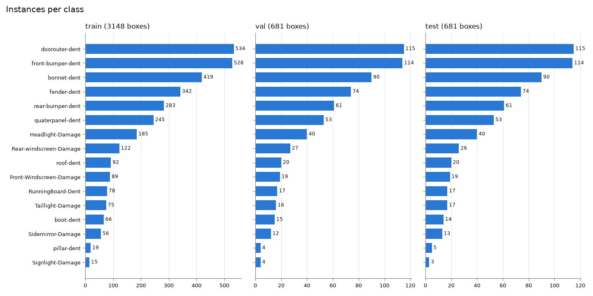

# Vehicle Damage Detection

Fine-tuning COCO-pretrained YOLO models (YOLOv8n / YOLO11n / YOLO11s) to detect car damage
**per car part** (e.g. front-bumper dent, headlight damage, windscreen damage), then turning the
detections into a simple insurance-claim style report.

> **Status:** work in progress (Day 4 of 7). Every number in this README comes from a run
> I actually performed. Sections marked `TODO` are not filled in yet.

## Problem & motivation
TODO (Day 7)

## Demo
TODO (Day 6): Hugging Face Spaces link + screenshot/GIF

## Dataset

**Source:** [Car Damage Detection by Root on Roboflow Universe](https://universe.roboflow.com/root-6ntpq/car-damage-detection-u0q4r),
version 2: 3,058 images, bounding-box annotations, no preprocessing or augmentation, CC BY 4.0.
17 classes that combine **car part + damage**:
`Bodypanel-Dent`, `bonnet-dent`, `boot-dent`, `doorouter-dent`, `fender-dent`, `front-bumper-dent`,
`pillar-dent`, `quaterpanel-dent`, `rear-bumper-dent`, `roof-dent`, `RunningBoard-Dent`,
`Front-Windscreen-Damage`, `Rear-windscreen-Damage`, `Headlight-Damage`, `Taillight-Damage`,
`Signlight-Damage`, `Sidemirror-Damage`.

The published split is 75/22/3 (only 79 test images), so the data is re-split after
de-duplication (see Data audit).

**Why this dataset.** Candidates compared on Day 1:

| Candidate | Images | Classes | Notes | Verdict |
|---|---|---|---|---|
| `root-6ntpq/car-damage-detection` v2 | 3,058 | 17 (part + damage) | Says *which part* is damaged, which is useful for claim cost estimation. Native boxes. No scratch/crack classes; some classes overlap in meaning (`Bodypanel-Dent` vs `doorouter-dent`) | **Chosen** |
| `dr-ulglr/carsdd` v3 (CarDD) | 4,000 | 6 (damage type) | Damage *type* only (dent, scratch, crack, ...). Original CarDD is licensed for non-commercial research only | Runner-up |
| `trialworkspace/car-damage-detection` | 182 | 3 | Too small for a reliable test set | Rejected |
| `ratchakrit/car-damage-merged` v2 | 8,971 | 6 | Merges likely overlapping CarDD copies (leakage risk); images stretched + histogram-equalized at export | Rejected |
| `yolov8tests/car-damage-detection-6` | 3,000 | 9, named `0`–`8` | Class meaning undocumented | Rejected |

**Trade-off accepted:** this dataset has no `scratch`, `crack` or `flat tire` classes, so the model
reports part-level dents and glass/lamp/mirror damage rather than fine-grained damage types.

**License note.** CC BY 4.0 as listed on Roboflow Universe; the original image source is not
documented. The dataset is downloaded by script and never redistributed in this repo.

### Data audit

`src/data_audit.py` checks class balance, duplicates/leakage (perceptual hash), invalid labels,
corrupted files, and image/box size distributions. `src/clean_data.py` applies the fixes and
writes a new dataset version. Full reports: [`reports/data_audit/raw`](reports/data_audit/raw/audit.md)
and [`reports/data_audit/clean`](reports/data_audit/clean/audit.md).

**What the audit found in the raw export (3,058 images, 4,747 boxes):**

| Finding | Count | Action |
|---|---|---|
| Near-duplicate images (pHash distance ≤ 10) | 152 groups, 170 redundant images | Keep one per group (most boxes, then highest resolution) |
| …of which span different splits (train/valid/test **leakage**) | 65 groups | Removed by de-duplication + re-split |
| …of which the copies are labeled differently | 44 groups | Same as above. This shows annotation inconsistency |
| Images with an empty label file | 70 (69 of the 79 test images) | Dropped. Visual check: they show clear damage, so labels are missing |
| Degenerate boxes (< 2 px side) | 3 | Dropped |
| Duplicate boxes (same class, IoU ≥ 0.9) | 1 | Dropped |
| `Bodypanel-Dent` class | 1 instance (a degenerate box) | Class removed → 16 classes |
| Corrupted images / unknown class ids / out-of-bounds boxes | 0 | — |

The original test split was effectively unusable: 79 images, but only 13 boxes.

**Before → after**

| | Raw | Clean |
|---|---|---|
| Images | 3,058 | 2,827 |
| Boxes | 4,747 | 4,527 |
| Classes | 17 | 16 |
| Split (train / val / test images) | 2,301 / 678 / 79 | 1,976 / 424 / 427 |
| Test boxes | 13 | 681 |
| Cross-split near-duplicate groups | 65 | 0 |
| Imbalance (largest / smallest class) | 812 | 35.0 |

**Key decisions**

- **Duplicate threshold = 10 (pHash Hamming distance, 64-bit hash).** Chosen by eyeballing random
  pairs at distances 8, 10, 12 and 14. Every sampled pair at ≤ 10 was the same photo (re-crops,
  different stock-photo watermarks). At 12, different photos start to appear.
- **Roboflow file names were not used for de-duplication.** Generic names such as `images-1-_jpg`
  repeat across *different* photos, which I checked visually.
- **Re-split 70/15/15, seed 42, stratified on each image's rarest class** so that rare classes
  (`pillar-dent`, `Signlight-Damage`) still appear in val/test. Running the cleaning script twice
  produces an identical `manifest.csv`, and the Colab notebook checks its MD5 against the local
  build before training.
- **Cross-platform reproducibility bugs caught by that checksum.** (1) Extracting the Roboflow zip
  with Windows Explorer silently skipped 7 images whose paths exceeded 260 characters.
  `download_data.py` now checks the image count against Roboflow's README. (2) `WindowsPath`
  sorts case-insensitively, while Linux sorts case-sensitively, so the seeded shuffle saw a
  different order. Files are now sorted by plain name.

**Things the audit surfaced that cleaning cannot fix** (they feed into Limitations):

- **Low resolution.** 1,644 / 2,827 images (58%) have a longest side under 320 px (e.g. 259×194
  thumbnails). 68% are under 640 px.
- **Rare classes.** `pillar-dent` (28 boxes) and `Signlight-Damage` (22) leave only 3–4 test
  instances, so their per-class AP will be noisy.
- **Label style.** Boxes are large (median box covers 12.5% of the image; no box is below 0.1%), so
  this is a coarse "damaged region per part" dataset, not a fine-grained scratch dataset. Some
  boxes are loose, and overlapping part classes are common (e.g. `Headlight-Damage` inside
  `front-bumper-dent`).
- **Stock-photo watermarks** (iStock, Shutterstock, Dreamstime, Alamy) appear on many images.
- pHash catches re-crops only up to a point. Heavily zoomed crops of the same scene can remain
  as separate images.



## Method

**Transfer learning.** Every model starts from COCO-pretrained weights. COCO has 118k images
that already include cars, so the early layers have learned generic features such as edges,
textures, reflections and car shapes. With only ~2k training images, training from scratch would
overfit. Fine-tuning reuses those features and mainly learns the new task: 16 damage classes
replace COCO's 80-class head.

**Experiments.** All runs use the same cleaned split, `seed=42`, `deterministic=True`, batch 16
and the same budget of **60 epochs** with early stopping disabled. Settings come from
[`configs/train_base.yaml`](configs/train_base.yaml). Each experiment file in
[`configs/experiments/`](configs/experiments) changes one thing:

| ID | Model | Setting | Purpose |
|---|---|---|---|
| E1 | YOLOv8n | full fine-tune, defaults | baseline |
| E2 | YOLO11n | full fine-tune, defaults | newer architecture vs baseline |
| E3 | YOLO11s | full fine-tune, defaults | model size vs accuracy/speed |
| E4 | YOLO11n | `imgsz=416` (vs 640) | 58% of images are < 320 px, so 640 mostly upsamples. Does a smaller input keep accuracy at lower cost? |
| E5 | YOLO11n | `freeze=10` (backbone frozen) | frozen backbone vs full fine-tune |

Design choices:
- **60 epochs, same for every run.** This is enough for fine-tuning to converge on ~2k images, and
  five runs still fit into free Colab sessions. Disabling early stopping keeps the comparison fair:
  every run gets the same budget, and the best epoch is chosen on val.
- **Model selection uses val only.** The test split is touched once, in the final evaluation (Day 5).
- **`cache=disk`, not `ram`.** Ultralytics warns that RAM caching can make training non-deterministic.
- **Colab realities.** Runs are written to Google Drive. If a session dies, re-running the same
  command resumes from `last.pt`, and finished runs are skipped. Each run writes `summary.json`,
  and one row per experiment goes to `experiments.csv`.
- **GPU determinism caveat.** Even with fixed seeds, some CUDA kernels are not bit-exact, so
  re-runs can differ slightly in the last decimals.

## Results

### Training runs (validation split)

From [`reports/experiments.csv`](reports/experiments.csv). Setup: Colab Tesla T4, 60 epochs, seed 42,
best checkpoint by val mAP50-95. Δ is relative to E2 (YOLO11n, 640), the reference for E4 and E5.

| ID | Model | Setting | val mAP50 | val mAP50-95 | Best epoch | Train time (min) | best.pt (MB) |
|---|---|---|---|---|---|---|---|
| E1 | YOLOv8n | defaults | 0.438 (−0.012) | 0.202 (−0.006) | 51 | 31.3 | 6.2 |
| E2 | YOLO11n | defaults | 0.450 | 0.208 | 31 | 32.6 | 5.2 |
| E3 | YOLO11s | defaults | 0.466 (+0.016) | 0.212 (+0.004) | 60 | 37.0 | 18.3 |
| E4 | YOLO11n | imgsz 416 | **0.479 (+0.029)** | **0.223 (+0.015)** | 40 | **22.3** | 5.2 |
| E5 | YOLO11n | freeze=10 | 0.395 (−0.055) | 0.187 (−0.021) | 34 | 31.0 | 5.2 |

Caveat: one seed per run and a 424-image val split. Val mAP50-95 moves by ±0.006–0.009 (std)
from epoch to epoch in epochs 40–60, and picking the single best epoch on val is optimistic. The
mean over epochs 40–60 is a steadier comparison: E1 0.194, E2 0.194, E3 0.199, **E4 0.203**,
E5 0.171. E4 stays ahead on that measure too, but by a smaller margin (+0.009 vs E2). Training
curves show val box/DFL loss bottoming out around epochs 10–28 and then rising, while train
loss keeps falling: mild overfitting on localization. The drop in train loss at epoch 50 is
ultralytics switching mosaic augmentation off for the last 10 epochs (`close_mosaic=10`).
Final numbers on the held-out test split: TODO (Day 5).

## Error analysis
TODO (Day 5)

## Severity rules
TODO (Day 6)

## Setup

Local environment: Python 3.12, NVIDIA GPU (for local inference/demo).

```bash
python -m venv .venv
.venv\Scripts\activate            # Windows (Linux/macOS: source .venv/bin/activate)
pip install torch torchvision --index-url https://download.pytorch.org/whl/cu128
pip install -r requirements.txt
copy .env.example .env            # then put your ROBOFLOW_API_KEY in .env
python -m src.download_data       # -> data/raw/car-damage-v2/
python -m src.data_audit --data data/raw/car-damage-v2 --out reports/data_audit/raw
python -m src.clean_data          # -> data/clean/car-damage-v2/ + configs/data.yaml
python -m src.data_audit --data data/clean/car-damage-v2 --out reports/data_audit/clean
```

## Reproduce

**Train (Google Colab, free T4).** Open [`notebooks/train_colab.ipynb`](notebooks/train_colab.ipynb)
in Colab and add a `ROBOFLOW_API_KEY` secret. The notebook clones this repo, rebuilds the cleaned
split (checking it against the expected manifest checksum), and runs
`python -m src.train --exp configs/experiments/<ID>.yaml` for E1–E5.

Local smoke test (a few minutes, checks the pipeline end to end):

```bash
python -m src.train --exp configs/experiments/E2.yaml --project runs/smoke --results-csv runs/smoke/experiments.csv --set epochs=2 fraction=0.1
```

Evaluate / demo: TODO (Day 5–6)

## Limitations
- **One seed per experiment.** Differences of about 0.01 mAP50-95 between runs are within noise.
  Repeating E2/E4 with more seeds was considered and skipped to stay within the 7-day timeline.
- **Equal epoch budget.** YOLO11s (E3) was still at its best at the final epoch (60), so it may be
  under-trained relative to the nano models.
- TODO (Day 5–7)

## What I learned
TODO

## Roadmap / future work
- Instance segmentation (`yolo11n-seg`) for precise damage shape and area
- Add a damage-*type* model trained on CarDD (dent / scratch / crack / ...) and combine it with
  this part-level model, e.g. "scratch on front bumper"
- OCR module (e.g. Thai license plates / claim documents) for an end-to-end claim pipeline
