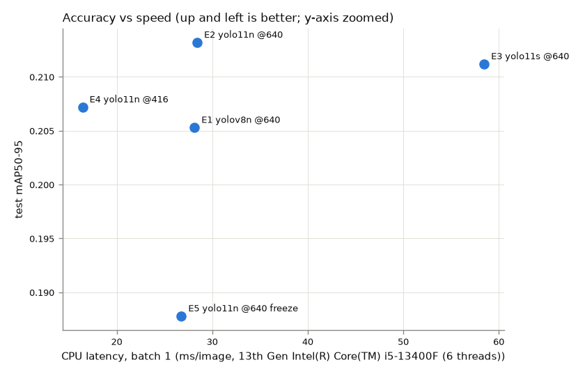

# Vehicle Damage Detection

Fine-tuning COCO-pretrained YOLO models (YOLOv8n / YOLO11n / YOLO11s) to detect car damage
**per car part** (e.g. front-bumper dent, headlight damage, windscreen damage), then turning the
detections into a simple insurance-claim style report.

> **Status:** work in progress (Day 6 of 7). Every number in this README comes from a run
> I actually performed. Sections marked `TODO` are not filled in yet.

## Problem & motivation
TODO (Day 7)

## Demo
Live demo (Streamlit Community Cloud): TODO, link after deployment. Screenshot/GIF: TODO (Day 7)

## Dataset

**Source:** [Car Damage Detection by Root on Roboflow Universe](https://universe.roboflow.com/root-6ntpq/car-damage-detection-u0q4r),
version 2: 3,058 images, bounding-box annotations, no preprocessing or augmentation, CC BY 4.0.
17 classes that combine **car part + damage**:
`Bodypanel-Dent`, `bonnet-dent`, `boot-dent`, `doorouter-dent`, `fender-dent`, `front-bumper-dent`,
`pillar-dent`, `quaterpanel-dent`, `rear-bumper-dent`, `roof-dent`, `RunningBoard-Dent`,
`Front-Windscreen-Damage`, `Rear-windscreen-Damage`, `Headlight-Damage`, `Taillight-Damage`,
`Signlight-Damage`, `Sidemirror-Damage`.

The published split is 75/22/3 (only 79 test images), so the data is re-split after
de-duplication (see Data audit).

**Why this dataset.** Candidates compared on Day 1:

| Candidate | Images | Classes | Notes | Verdict |
|---|---|---|---|---|
| `root-6ntpq/car-damage-detection` v2 | 3,058 | 17 (part + damage) | Says *which part* is damaged, which is useful for claim cost estimation. Native boxes. No scratch/crack classes; some classes overlap in meaning (`Bodypanel-Dent` vs `doorouter-dent`) | **Chosen** |
| `dr-ulglr/carsdd` v3 (CarDD) | 4,000 | 6 (damage type) | Damage *type* only (dent, scratch, crack, ...). Original CarDD is licensed for non-commercial research only | Runner-up |
| `trialworkspace/car-damage-detection` | 182 | 3 | Too small for a reliable test set | Rejected |
| `ratchakrit/car-damage-merged` v2 | 8,971 | 6 | Merges likely overlapping CarDD copies (leakage risk); images stretched + histogram-equalized at export | Rejected |
| `yolov8tests/car-damage-detection-6` | 3,000 | 9, named `0`–`8` | Class meaning undocumented | Rejected |

**Trade-off accepted:** this dataset has no `scratch`, `crack` or `flat tire` classes, so the model
reports part-level dents and glass/lamp/mirror damage rather than fine-grained damage types.

**License note.** CC BY 4.0 as listed on Roboflow Universe; the original image source is not
documented. The dataset is downloaded by script and never redistributed in this repo.

### Data audit

`src/data_audit.py` checks class balance, duplicates/leakage (perceptual hash), invalid labels,
corrupted files, and image/box size distributions. `src/clean_data.py` applies the fixes and
writes a new dataset version. Full reports: [`reports/data_audit/raw`](reports/data_audit/raw/audit.md)
and [`reports/data_audit/clean`](reports/data_audit/clean/audit.md).

**What the audit found in the raw export (3,058 images, 4,747 boxes):**

| Finding | Count | Action |
|---|---|---|
| Near-duplicate images (pHash distance ≤ 10) | 152 groups, 170 redundant images | Keep one per group (most boxes, then highest resolution) |
| …of which span different splits (train/valid/test **leakage**) | 65 groups | Removed by de-duplication + re-split |
| …of which the copies are labeled differently | 44 groups | Same as above. This shows annotation inconsistency |
| Images with an empty label file | 70 (69 of the 79 test images) | Dropped. Visual check: they show clear damage, so labels are missing |
| Degenerate boxes (< 2 px side) | 3 | Dropped |
| Duplicate boxes (same class, IoU ≥ 0.9) | 1 | Dropped |
| `Bodypanel-Dent` class | 1 instance (a degenerate box) | Class removed → 16 classes |
| Corrupted images / unknown class ids / out-of-bounds boxes | 0 | — |

The original test split was effectively unusable: 79 images, but only 13 boxes.

**Before → after**

| | Raw | Clean |
|---|---|---|
| Images | 3,058 | 2,827 |
| Boxes | 4,747 | 4,527 |
| Classes | 17 | 16 |
| Split (train / val / test images) | 2,301 / 678 / 79 | 1,976 / 424 / 427 |
| Test boxes | 13 | 681 |
| Cross-split near-duplicate groups | 65 | 0 |
| Imbalance (largest / smallest class) | 812 | 35.0 |

**Key decisions**

- **Duplicate threshold = 10 (pHash Hamming distance, 64-bit hash).** Chosen by eyeballing random
  pairs at distances 8, 10, 12 and 14. Every sampled pair at ≤ 10 was the same photo (re-crops,
  different stock-photo watermarks). At 12, different photos start to appear.
- **Roboflow file names were not used for de-duplication.** Generic names such as `images-1-_jpg`
  repeat across *different* photos, which I checked visually.
- **Re-split 70/15/15, seed 42, stratified on each image's rarest class** so that rare classes
  (`pillar-dent`, `Signlight-Damage`) still appear in val/test. Running the cleaning script twice
  produces an identical `manifest.csv`, and the Colab notebook checks its MD5 against the local
  build before training.
- **Cross-platform reproducibility bugs caught by that checksum.** (1) Extracting the Roboflow zip
  with Windows Explorer silently skipped 7 images whose paths exceeded 260 characters.
  `download_data.py` now checks the image count against Roboflow's README. (2) `WindowsPath`
  sorts case-insensitively, while Linux sorts case-sensitively, so the seeded shuffle saw a
  different order. Files are now sorted by plain name.

**Things the audit surfaced that cleaning cannot fix** (they feed into Limitations):

- **Low resolution.** 1,644 / 2,827 images (58%) have a longest side under 320 px (e.g. 259×194
  thumbnails). 68% are under 640 px.
- **Rare classes.** `pillar-dent` (28 boxes) and `Signlight-Damage` (22) leave only 3–4 test
  instances, so their per-class AP will be noisy.
- **Label style.** Boxes are large (median box covers 12.5% of the image; no box is below 0.1%), so
  this is a coarse "damaged region per part" dataset, not a fine-grained scratch dataset. Some
  boxes are loose, and overlapping part classes are common (e.g. `Headlight-Damage` inside
  `front-bumper-dent`).
- **Stock-photo watermarks** (iStock, Shutterstock, Dreamstime, Alamy) appear on many images.
- pHash catches re-crops only up to a point. Heavily zoomed crops of the same scene can remain
  as separate images.


## Method

**Transfer learning.** Every model starts from COCO-pretrained weights. COCO has 118k images
that already include cars, so the early layers have learned generic features such as edges,
textures, reflections and car shapes. With only ~2k training images, training from scratch would
overfit. Fine-tuning reuses those features and mainly learns the new task: 16 damage classes
replace COCO's 80-class head.

**Experiments.** All runs use the same cleaned split, `seed=42`, `deterministic=True`, batch 16
and the same budget of **60 epochs** with early stopping disabled. Settings come from
[`configs/train_base.yaml`](configs/train_base.yaml). Each experiment file in
[`configs/experiments/`](configs/experiments) changes one thing:

| ID | Model | Setting | Purpose |
|---|---|---|---|
| E1 | YOLOv8n | full fine-tune, defaults | baseline |
| E2 | YOLO11n | full fine-tune, defaults | newer architecture vs baseline |
| E3 | YOLO11s | full fine-tune, defaults | model size vs accuracy/speed |
| E4 | YOLO11n | `imgsz=416` (vs 640) | 58% of images are < 320 px, so 640 mostly upsamples. Does a smaller input keep accuracy at lower cost? |
| E5 | YOLO11n | `freeze=10` (backbone frozen) | frozen backbone vs full fine-tune |

Design choices:
- **60 epochs, same for every run.** This is enough for fine-tuning to converge on ~2k images, and
  five runs still fit into free Colab sessions. Disabling early stopping keeps the comparison fair:
  every run gets the same budget, and the best epoch is chosen on val.
- **Model selection uses val only.** The test split is touched once, in the final evaluation (Day 5).
- **`cache=disk`, not `ram`.** Ultralytics warns that RAM caching can make training non-deterministic.
- **Colab realities.** Runs are written to Google Drive. If a session dies, re-running the same
  command resumes from `last.pt`, and finished runs are skipped. Each run writes `summary.json`,
  and one row per experiment goes to `experiments.csv`.
- **GPU determinism caveat.** Even with fixed seeds, some CUDA kernels are not bit-exact, so
  re-runs can differ slightly in the last decimals.

## Results

### Training runs (validation split)

From [`reports/experiments.csv`](reports/experiments.csv). Setup: Colab Tesla T4, 60 epochs, seed 42,
best checkpoint by val mAP50-95. Δ is relative to E2 (YOLO11n, 640), the reference for E4 and E5.

| ID | Model | Setting | val mAP50 | val mAP50-95 | Best epoch | Train time (min) | best.pt (MB) |
|---|---|---|---|---|---|---|---|
| E1 | YOLOv8n | defaults | 0.438 (−0.012) | 0.202 (−0.006) | 51 | 31.3 | 6.2 |
| E2 | YOLO11n | defaults | 0.450 | 0.208 | 31 | 32.6 | 5.2 |
| E3 | YOLO11s | defaults | 0.466 (+0.016) | 0.212 (+0.004) | 60 | 37.0 | 18.3 |
| E4 | YOLO11n | imgsz 416 | **0.479 (+0.029)** | **0.223 (+0.015)** | 40 | **22.3** | 5.2 |
| E5 | YOLO11n | freeze=10 | 0.395 (−0.055) | 0.187 (−0.021) | 34 | 31.0 | 5.2 |

Caveat: one seed per run and a 424-image val split. Val mAP50-95 moves by ±0.006–0.009 (std)
from epoch to epoch in epochs 40–60, and picking the single best epoch on val is optimistic. The
mean over epochs 40–60 is a steadier comparison: E1 0.194, E2 0.194, E3 0.199, **E4 0.203**,
E5 0.171. E4 stays ahead on that measure too, but by a smaller margin (+0.009 vs E2). Training
curves show val box/DFL loss bottoming out around epochs 10–28 and then rising, while train
loss keeps falling: mild overfitting on localization. The drop in train loss at epoch 50 is
ultralytics switching mosaic augmentation off for the last 10 epochs (`close_mosaic=10`).
Final numbers on the held-out test split are below.

### Test split (final evaluation)

From [`reports/evaluation/test_metrics.csv`](reports/evaluation/test_metrics.csv), produced by
`python -m src.evaluate`. 427 test images, 681 boxes, never used for any training or model-selection
decision. Each model was evaluated at its training `imgsz`. Latency is batch size 1, end-to-end
(preprocess + inference + NMS), on images already in memory. It is the minimum over 5 interleaved
rounds of the median over 200 (GPU) / 100 (CPU) images, on an RTX 4070 SUPER and an i5-13400F
(6 threads).

| ID | Model | imgsz | test mAP50 | test mAP50-95 | P | R | CPU ms/img | GPU ms/img | Params (M) | GFLOPs | best.pt (MB) | Train (min, T4) |
|---|---|---|---|---|---|---|---|---|---|---|---|---|
| E1 | YOLOv8n | 640 | 0.434 | 0.205 | 0.462 | 0.433 | 28.1 | 7.6 | 3.14 | 8.8 | 6.2 | 31.3 |
| E2 | YOLO11n | 640 | 0.415 | **0.213** | 0.518 | 0.414 | 28.4 | 9.3 | 2.61 | 6.6 | 5.2 | 32.6 |
| E3 | YOLO11s | 640 | **0.440** | 0.211 | 0.550 | 0.430 | 58.5 | 9.8 | 9.43 | 21.7 | 18.3 | 37.0 |
| **E4** | **YOLO11n** | **416** | 0.430 | 0.207 | 0.550 | 0.432 | **16.4** | 9.1 | 2.61 | **2.8** | 5.2 | **22.3** |
| E5 | YOLO11n, freeze=10 | 640 | 0.380 | 0.188 | 0.603 | 0.354 | 26.8 | 9.6 | 2.61 | 6.6 | 5.2 | 31.0 |



**Reading the table**

- **E1-E4 are statistically tied on accuracy.** Test mAP50-95 spans 0.205-0.213 (< 0.01), and the
  ranking differs from val: E4 led on val, E2 leads on test. That is what single-seed noise looks
  like, and it confirms that the val lead from best-epoch selection was optimistic.
- **Only E5 is clearly worse:** -0.025 mAP50-95 and -0.06 recall vs E2 (see below).
- **Speed separates the models.** On CPU, YOLO11s costs ~2x the nano models, and nano at 416 is
  ~1.7x faster than at 640 (2.4x fewer FLOPs). On the RTX 4070 every model takes ~8-10 ms. That is
  dominated by Python, preprocessing and NMS overhead, not the network, so GPU latency does not
  distinguish them. E2 and E5 are the same architecture, and their CPU numbers (28.4 vs 26.8 ms)
  show the remaining measurement noise (about +/-2 ms).
- **Measurement note.** With default settings, CPU latency of the *same* model varied up to 4x between
  runs on this Windows desktop: ultralytics resets torch threads to 8, plus background throttling.
  Pinning threads and taking the min over interleaved rounds made it repeatable.

**E5: frozen backbone vs full fine-tune.** Freezing layers 0-9 (the backbone up to SPPF) lowered test
mAP50-95 from 0.213 to 0.188 and recall from 0.41 to 0.35. Precision went up (0.60), so the frozen
model is more conservative: it only fires on patterns its COCO features already separate well.
Training time barely changed (31.0 vs 32.6 min on a T4) because these runs appear to be input-bound
(2 CPU workers, per-epoch validation), not backward-pass-bound. E3 being 3.6x bigger but only 13%
slower supports that. This is an inference, not a measurement. *When to freeze:* very small datasets
(a few hundred images) where full fine-tuning overfits, a target domain close to the pretraining
data, limited GPU memory, or many tasks sharing one backbone. *When to fine-tune fully:* a few
thousand images whose visual domain differs from COCO (damage texture, crumpled metal, glass
cracks), which is this case.

**Final model: E4 (YOLO11n, imgsz 416).** Its accuracy is within noise of the best run (-0.006
mAP50-95 vs E2, +0.015 mAP50), and it is the fastest on CPU (16.4 ms vs 28.4 ms), has the fewest
FLOPs, is 5.2 MB, and trained 32% faster. The demo runs on CPU (free Streamlit Community Cloud), so CPU
latency is the deciding factor. YOLO11s brings no measurable accuracy gain for 3.6x the size and
~3.5x the CPU latency of E4.

## Error analysis

Run on the final model (E4) with `python -m src.error_analysis --run E4`. Outputs are in
[`reports/error_analysis/`](reports/error_analysis). The confidence threshold was chosen to maximize
F1 on **val** (conf = 0.30, val F1 0.52) and then applied to test. Predictions were matched to ground
truth per image (same class, IoU >= 0.5).

**Test at conf 0.30:** 338 TP, precision 0.57, recall 0.50, F1 0.53.

| Error type | Count | Meaning |
|---|---|---|
| FN missed | 224 | no prediction overlaps the ground-truth box (IoU < 0.1) |
| FN localization | 96 | found roughly, but IoU < 0.5 |
| FN wrong class | 23 | covered by a box of another class |
| FP background | 108 | prediction overlaps no ground-truth box |
| FP wrong class | 68 | overlaps a box of another class |
| FP localization | 64 | right class, IoU 0.1-0.5 |
| FP duplicate | 12 | second box on an already-matched object |

Top class confusions (ground truth -> prediction): rear-bumper -> front-bumper (5),
rear-bumper -> rear-windscreen (2), boot -> bonnet (2), quarter-panel -> fender (2), roof -> bonnet (2).

Per class (see [`per_class_errors.csv`](reports/error_analysis/per_class_errors.csv) and
[`per_class_ap.png`](reports/evaluation/per_class_ap.png)): `pillar-dent` (4 test boxes) and
`Signlight-Damage` (3) were never detected. Recall is <= 0.36 for `boot`, `RunningBoard`, `roof`,
`Headlight`, `Front-Windscreen`, `rear-bumper` and `quaterpanel`. `Headlight-Damage` has 265 boxes
but AP50-95 of only 0.09, because its boxes usually sit inside a `front-bumper-dent` box.

**Causes, from visually reviewing the example sheets** (16 images each, highest-confidence first for
FPs). Counts below are from those samples, not the full test set.

| Cause | Where it shows up | Example sheet |
|---|---|---|
| **Missing labels: the model is right, the label set is incomplete.** About 7 of the 16 top "background" FPs are real damage on a part that was not annotated (e.g. a broken side mirror inside a large door box, a damaged headlight or bumper with no box). | FP background | [`fp_background.jpg`](reports/error_analysis/fp_background.jpg) |
| **Secondary damage next to a detected part.** About 6 of the 16 sampled misses: the model finds the main damaged panel but not the neighbouring one (e.g. bumper found, quarter panel missed). | FN missed | [`fn_missed.jpg`](reports/error_analysis/fn_missed.jpg) |
| **Subtle, low-contrast damage.** About 5 of 16 misses: shallow dents and light scratches with no strong texture, some on low-resolution thumbnails; plus one night photo. | FN missed | [`fn_missed.jpg`](reports/error_analysis/fn_missed.jpg) |
| **Close-ups without context.** Front vs rear windscreen, front vs rear bumper, boot vs bonnet (a Porsche 911!), taillight vs signlight: from a tight crop even a human cannot tell which part it is. | FP/FN wrong class | [`fp_wrong_class.jpg`](reports/error_analysis/fp_wrong_class.jpg) |
| **Undefined box extent.** One box per dent vs one per panel is labelled inconsistently. The model often draws the whole panel where the label covers one dent, or the reverse, so IoU < 0.5 although the detection is useful. This is also why mAP50-95 is low. | FN/FP localization | [`fn_localization.jpg`](reports/error_analysis/fn_localization.jpg) |
| **True false alarms.** Reflections on shiny panels, intact panels next to damage, a person's face. About 4 of the 16 top background FPs. | FP background | [`fp_background.jpg`](reports/error_analysis/fp_background.jpg) |

**Concrete fixes, highest expected impact first**

1. **Fix the labels before changing the model.** E1-E4 perform the same, so the model is not the
   bottleneck. Write an annotation guideline (one box per damaged part, covering the damaged area
   only; label every damaged part) and re-label at least the test set, then the training images
   with the most FP/FN. Part of the measured error is label noise, so true accuracy is likely higher
   than reported.
2. **Simplify the class scheme.** Merge classes that cannot be told apart or are too rare:
   `Signlight` -> `Taillight/Headlight`, `pillar-dent` -> `doorouter-dent`, front/rear windscreen
   -> `windscreen`. Or split the problem into *damage type* + *car part* (two heads or two models),
   which is closer to how a claim is written.
3. **Add context.** Collect or keep wider shots so front vs rear is decidable. For close-ups, a
   separate car-part segmentation model can provide the part label.
4. **Resolution for subtle dents.** Prefer higher-resolution sources. A segmentation model
   (`yolo11n-seg`) would also remove the box-extent ambiguity by outlining the damage itself.

## Severity rules

[`src/severity.py`](src/severity.py) turns detections into a claim-style severity. **These are
hand-written heuristics, not learned, and not validated against repair costs or claim outcomes.**

1. **Base level by damaged part**
   | Level | Classes | Reason |
   |---|---|---|
   | minor | door, fender, front/rear bumper, bonnet, boot, quarter-panel, running-board dents | cosmetic body-panel repair |
   | moderate | headlight, taillight, signlight, side mirror, rear windscreen, roof dent | part replacement; lights and mirrors are needed for road legality; roof repair is labor-intensive |
   | severe | front windscreen, pillar dent | driver visibility / structural pillar |
2. **Size:** a damage whose box covers ≥ 30% of the image is raised one level. 0.30 ≈ the 75th
   percentile of training-box area (median 0.12).
3. **Overall** = the most severe single damage, raised one level when there are ≥ 3 detections
   (14.5% of training images have 3 or more boxes). No detections → `none`.

Known weakness: area *relative to the image* depends on camera distance. A close-up of one small
fender dent covers 43% of the frame and becomes "moderate". A real system would need the car's
extent in the image (e.g. a car/part segmentation model) or physical measurements.

**Claim report** ([`src/predict.py`](src/predict.py)), image in → annotated image + JSON:

```json
{
  "image": "car_fender-69-....jpg",
  "damages": [
    {"type": "fender-dent", "confidence": 0.592, "bbox": [223, 113, 690, 503],
     "area_ratio": 0.4271, "severity": "moderate"}
  ],
  "overall_severity": "moderate",
  "conf_threshold": 0.3,
  "note": "Severity levels are rule-based heuristics (src/severity.py), not learned or validated against repair costs."
}
```

The default confidence threshold of 0.30 maximizes F1 on the val split.

## Setup

Local environment: Python 3.12, NVIDIA GPU (for local inference/demo).

```bash
python -m venv .venv
.venv\Scripts\activate            # Windows (Linux/macOS: source .venv/bin/activate)
pip install torch torchvision --index-url https://download.pytorch.org/whl/cu128
pip install -r requirements.txt
copy .env.example .env            # then put your ROBOFLOW_API_KEY in .env
python -m src.download_data       # -> data/raw/car-damage-v2/
python -m src.data_audit --data data/raw/car-damage-v2 --out reports/data_audit/raw
python -m src.clean_data          # -> data/clean/car-damage-v2/ + configs/data.yaml
python -m src.data_audit --data data/clean/car-damage-v2 --out reports/data_audit/clean
```

## Reproduce

**Train (Google Colab, free T4).** Open [`notebooks/train_colab.ipynb`](notebooks/train_colab.ipynb)
in Colab and add a `ROBOFLOW_API_KEY` secret. The notebook clones this repo, rebuilds the cleaned
split (checking it against the expected manifest checksum), and runs
`python -m src.train --exp configs/experiments/<ID>.yaml` for E1–E5.

Local smoke test (a few minutes, checks the pipeline end to end):

```bash
python -m src.train --exp configs/experiments/E2.yaml --project runs/smoke --results-csv runs/smoke/experiments.csv --set epochs=2 fraction=0.1
```

**Evaluate (local GPU/CPU).** Put the trained runs in `runs/E1` ... `runs/E5` (download from Google Drive), then:

```bash
python -m src.evaluate                 # test metrics, latency, per-class AP -> reports/evaluation/
python -m src.error_analysis --run E4  # FP/FN categories + example sheets -> reports/error_analysis/
```

**Predict / demo.**

```bash
python -m src.predict car.jpg --weights runs/E4/weights/best.pt   # -> outputs/car_annotated.jpg + car.json
streamlit run app/streamlit_app.py                                # demo at http://localhost:8501
```

Without `--weights`, `predict.py` and the app use `weights/car_damage_yolo11n_416.pt` if it
exists. Otherwise they download it from the Hugging Face model repo
[tatar01230/car-damage-yolo11n](https://huggingface.co/tatar01230/car-damage-yolo11n). Set the
`HF_MODEL_REPO` environment variable to use a different repo.

**Publish the weights to Hugging Face** (needs a write `HF_TOKEN` in `.env`):

```bash
python -m src.publish_hf --user <hf-username>   # weights + model card
```

**Deploy the demo (Streamlit Community Cloud, free).** At https://share.streamlit.io, sign in with
GitHub, then choose *Create app* → this repo, branch `main`, main file `app/streamlit_app.py`,
and Python 3.12 under *Advanced settings*. Cloud dependencies are in
[`app/requirements.txt`](app/requirements.txt) (CPU-only PyTorch) and system packages are in
[`packages.txt`](packages.txt). The app downloads the weights from the Hugging Face model repo on first start.

Why not a Hugging Face Space: as of October 2026, Hugging Face refuses to create Gradio/Docker
Spaces on the free CPU tier for non-PRO accounts (`402 Payment Required`).

## Limitations
- **One seed per experiment.** Differences of about 0.01 mAP50-95 between runs are within noise.
  Repeating E2/E4 with more seeds was considered and skipped to stay within the 7-day timeline.
- **Equal epoch budget.** YOLO11s (E3) was still at its best at the final epoch (60), so it may be
  under-trained relative to the nano models.
- **Label noise caps the measurable accuracy.** Missing annotations and an inconsistent box extent
  are visible in the error analysis, so test metrics partly measure label quality.
- **Rare classes are effectively unsupported.** `pillar-dent` and `Signlight-Damage` were never
  detected on test (3-4 boxes each).
- **Latency numbers are from a desktop CPU/GPU.** The free Streamlit Cloud machine will be slower.
- **Severity is rule-based** and uses box area relative to the image, which depends on camera distance.
- TODO (Day 7)

## What I learned
TODO

## Roadmap / future work
- Instance segmentation (`yolo11n-seg`) for precise damage shape and area
- Add a damage-*type* model trained on CarDD (dent / scratch / crack / ...) and combine it with
  this part-level model, e.g. "scratch on front bumper"
- OCR module (e.g. Thai license plates / claim documents) for an end-to-end claim pipeline
